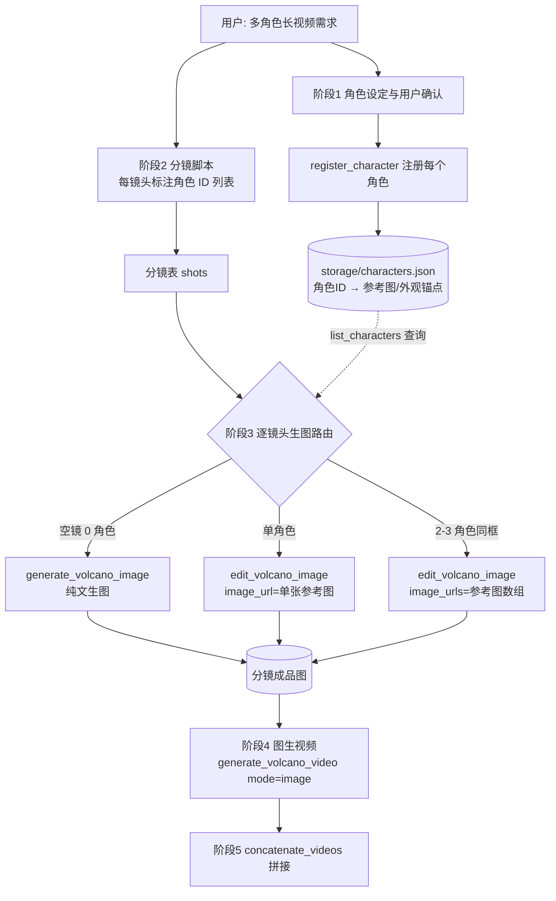

# 多角色一致性技术方案

> 状态：已实现（2026-11-25）
> 适用模块：长视频生成工作流（video-creator Skill）、图片编辑工具、角色注册表
> 阅读对象：PolyStudio 后端开发者 / Agent 工作流维护者

## 1. 背景与目标

### 1.1 改造前：单角色模型

原长视频工作流只支持「一个角色 + 多镜头」：所有含该角色的镜头都基于对话历史中的同一张角色图调用 `edit_volcano_image`，角色信息仅以自由文本记录在 `workspace/MEMORY.md`，无结构化映射，无法支撑多角色场景。

### 1.2 改造后目标

支持同一部长视频中出现多个不同角色（角色 A、B、C……），满足：

- 每个角色在多个镜头中形象一致
- 角色之间互不混淆（不串脸、不串服装道具）
- 同一镜头最多 3 个角色同框；超出则拆分镜头
- 视频生成与拼接链路零改动——一致性在**图片阶段**锁定

## 2. 关键设计约束（来自代码事实）

| 约束 | 来源 | 设计影响 |
|---|---|---|
| 图生视频只接受单张首帧 `image_url` | `app/tools/volcano_video_generation.py` | 多角色一致性只能在图片阶段解决，视频工具不感知角色 |
| 图片编辑 payload 的 `image` 字段支持字符串或数组 | `app/tools/volcano_image_generation.py` 编辑接口 | 多角色同框通过多参考图数组实现，无需引入新模型/新服务 |
| Agent 每次请求重建、工具无状态 | `app/services/agent_service.py` `create_agent()` | 角色状态必须落文件，不能放进程内存 |
| 工具统一用 `@tool` + Pydantic schema 暴露给 LLM | 全部 `app/tools/*.py` | 角色管理也实现为标准 LangChain 工具，由 LLM 自主调用 |

## 3. 整体架构



## 4. 数据模型：角色注册表

文件位置：`backend/storage/characters.json`（`storage/` 已在 `.gitignore`，属运行时数据）。

```json
{
  "project_id": "default",
  "characters": [
    {
      "character_id": "char_a1b2c3d4",
      "name": "小雨",
      "aliases": ["雨姐"],
      "reference_image": "/storage/images/volcano_xxx.jpg",
      "appearance": "齐肩黑发、米白色风衣、银色耳钉",
      "status": "confirmed",
      "created_at": "2026-11-25T10:00:00",
      "updated_at": "2026-11-25T10:00:00"
    }
  ]
}
```

字段说明：

| 字段 | 说明 |
|---|---|
| `character_id` | 系统生成的唯一 ID（`char_` + 8 位 hex），分镜与 prompt 只引用 ID，避免自然语言称呼混淆 |
| `name` / `aliases` | 角色名与口语别名；注册时按 name 和 aliases 做重名校验 |
| `reference_image` | 角色参考图，必须是已存在的本地 `/storage/` 路径 |
| `appearance` | 稳定外观锚点：发型类别、服装类别、职业身份、标志性道具。**禁止**写身高、体型、胖瘦、肤色深浅等易触发重绘漂移的属性 |
| `status` | 当前固定为 `confirmed`；只有用户确认过的角色图才允许注册 |

与 `workspace/MEMORY.md` 的分工：`characters.json` 管结构化、可查询的当前项目角色；MEMORY.md 继续管跨项目长期偏好，两者不混用。

> 当前为单项目注册表（`project_id` 固定 `default`）。未来支持多项目/画布隔离时，按 canvas_id 分文件或按 project_id 分组即可，工具接口无需破坏式变更。

## 5. 工具接口

### 5.1 角色管理工具（新增 `app/tools/character_tools.py`）

| 工具名 | 入参 | 行为 |
|---|---|---|
| `register_character` | name, reference_image, appearance, aliases? | 校验参考图路径存在 → 重名/别名冲突检查 → 生成 character_id 并原子写入 JSON |
| `list_characters` | 无 | 返回全部角色，生图前用于核对分镜中的 ID 均已注册 |
| `update_character_reference` | character_id, reference_image?, appearance?, aliases? | 按 ID 更新，至少传一个字段；参考图同样做路径校验 |

实现要点：

- 读写均带容错：文件不存在返回空注册表，JSON 损坏不抛死而是降级为空结构
- 写入采用临时文件 + `replace` 原子替换，避免写一半损坏
- 三个工具已在 `app/services/agent_service.py` 的工具列表中注册

### 5.2 图片编辑工具扩展（`app/tools/volcano_image_generation.py`）

`edit_volcano_image` 在原 `image_url` 基础上新增 `image_urls`：

| 参数 | 含义 | 规则 |
|---|---|---|
| `image_url` | 单参考图 | 与 `image_urls` 互斥，二选一 |
| `image_urls` | 多参考图列表 | 1-3 张；数组顺序即角色槽位顺序 |

校验与 payload 规则：

1. 两个参数必须且只能传一个，否则返回错误 JSON
2. `image_urls` 数量超出 1-3 直接报错并提示拆分镜头
3. 每张参考图独立转 Base64；单图时 payload 的 `image` 为字符串，多图时为数组
4. 返回体新增 `source_images`（列表），同时保留 `source_image`（首图）向后兼容

## 6. 镜头级参考图路由

分镜中每个镜头必须带角色标注，生图前按下表路由：

| 镜头标注 | 出镜角色数 | 工具 | 参考图入参 |
|---|---|---|---|
| `【空镜】` | 0 | `generate_volcano_image` | 无，纯文生图 |
| `【角色:ID_A】` | 1 | `edit_volcano_image` | `image_url` = ID_A 的 reference_image |
| `【角色:ID_A,ID_B】` | 2-3 | `edit_volcano_image` | `image_urls` = 各角色 reference_image，顺序与标注一致 |

路由伪代码：

```python
def route_shot_image_generation(shot, registry):
    char_ids = parse_character_ids(shot.annotation)
    chars = [registry.get(cid) for cid in char_ids]

    if not chars:
        return generate_volcano_image(prompt=shot.description, size=shot.size)

    anchored_prompt = build_anchored_prompt(shot, chars)  # 注入每个角色的外观锚点

    if len(chars) == 1:
        return edit_volcano_image(
            prompt=anchored_prompt,
            image_url=chars[0].reference_image,
        )

    return edit_volcano_image(
        prompt=anchored_prompt,
        image_urls=[c.reference_image for c in chars],  # 上限 3，工具层强校验
    )
```

## 7. 防角色混淆的四条硬约束

以下规则同时写在 `backend/skills/custom/video-creator/SKILL.md`，由 Agent 在生图时遵守：

1. **槽位=身份固定绑定**：`image_urls` 数组顺序就是角色槽位顺序，prompt 必须按相同顺序逐个写 `【角色名】(外观锚点)`，禁止「一个男人/另一个女人」类泛指
2. **空间位置显式化**：多角色同框时逐个写明站位（左/右/前景/后景）与互相关系（对视/背对等），避免身份互换
3. **外观锚点最小化**：只引用注册时的稳定锚点（发型/服装类别、职业、道具），不临时添加体型、肤色等易漂移属性；道具不得跨角色错配
4. **同框上限 3 人**：工具层与 Skill 层双重约束，超过 3 人的镜头必须拆分

## 8. 分镜标注规范

详见 `backend/skills/custom/video-creator/references/storyboard_format.md`，核心格式：

```
镜头3（5秒）【角色:char_xiaoyu01,char_chenmo02】：咖啡馆桌前两人对视，
        小雨居画面左侧穿米白色风衣，陈默居画面右侧穿黑色夹克戴细框眼镜……
镜头4（5秒）【空镜】：橱窗特写……
```

- 空镜：`【空镜】`
- 单角色：`【角色:character_id】`
- 多角色：`【角色:id1,id2】`，逗号分隔，顺序即参考图槽位顺序

## 9. 端到端工作流（7 步）

`video-creator` Skill 已按此重写：

1. 需求分析
2. **角色注册**：先生成正面角色图 → 用户确认 → `register_character` 落注册表
3. 分镜脚本：每镜头带角色 ID 标注，用户确认后才执行
4. 图片序列：`list_characters` 核对 → 按第 6 节路由逐镜头生图
5. 图生视频：`generate_volcano_video` `mode="image"`，单首帧，不感知角色
6. 视频拼接：`concatenate_videos`
7. 质量检查

## 10. 改动文件清单

| 文件 | 类型 | 说明 |
|---|---|---|
| `backend/app/tools/character_tools.py` | 新增 | 角色注册表 + 3 个管理工具 |
| `backend/app/tools/volcano_image_generation.py` | 修改 | `edit_volcano_image` 增加 `image_urls`，互斥/上限校验，payload 数组化 |
| `backend/app/services/agent_service.py` | 修改 | 注册 3 个角色工具（工具总数 18 → 21） |
| `backend/skills/custom/video-creator/SKILL.md` | 修改 | 新增角色注册步骤、路由表、防混淆约束，流程扩为 7 步 |
| `backend/skills/custom/video-creator/references/storyboard_format.md` | 修改 | 角色 ID 标注规范与多角色同框示例 |
| 视频生成 / 视频拼接工具 | 未改动 | 一致性在图片阶段闭环 |

## 11. 验证情况

### 已验证（本地）

- 三个 Python 文件 `py_compile` 通过，IDE 诊断无新增错误
- 角色工具 CRUD：非法路径/缺文件拦截、注册、重名与别名拒绝、列表、换图、错误 ID 处理
- 编辑工具入参校验：互斥规则、4 张超限拦截
- Mock HTTP 验证 payload 形态：单图 `image` 为字符串、双图为长度 2 的 Base64 数组，返回字段 `source_images` 正确

### 待真机确认

- **Seedream 多图数组（`image=[base64_1, base64_2]`）尚未用真实 API key 验证**。当前依据是编辑接口 payload 注释声明 `image` 支持数组。真机验证若字段名/结构有差异，只需调整 `edit_volcano_image_tool` 内 payload 组装处，上层工具接口与 Skill 流程不变。
- 3 人同框的实际出图稳定性（串脸概率）需用真实样本评估；如不达标，优先收紧为同框 ≤2 人而非改架构。

## 12. 已知边界与后续扩展

- **单角色也必须走注册流程**：统一镜头路由规则，不保留「对话历史找图」的旧旁路
- **换装/多造型**：当前一个角色只挂一张参考图。同一角色多造型（如校服/西装）需扩展为按造型版本存多图，列入二期
- **多项目隔离**：`characters.json` 当前全局单份，多画布并行创作时需按 project/canvas 维度隔离
- **无自动重生成闭环**：图片阶段不做人脸检测校验（虚拟人链路才有 `detect_face`），质量问题目前依赖第 7 步人工/Agent 复查后手动重生成
